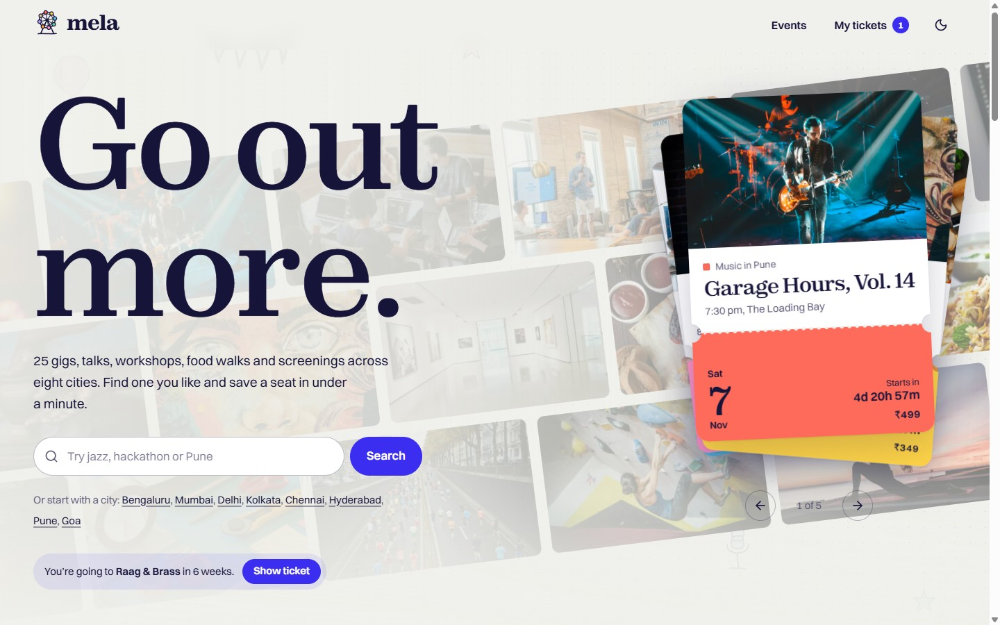
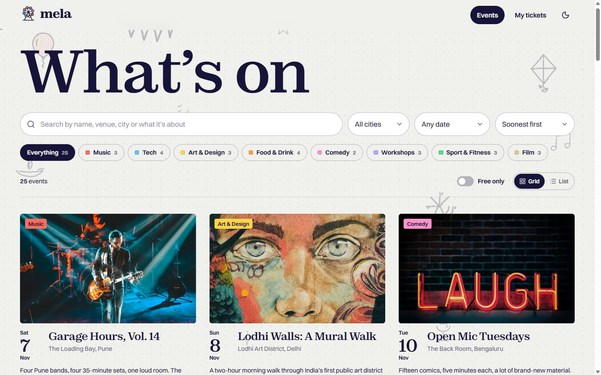
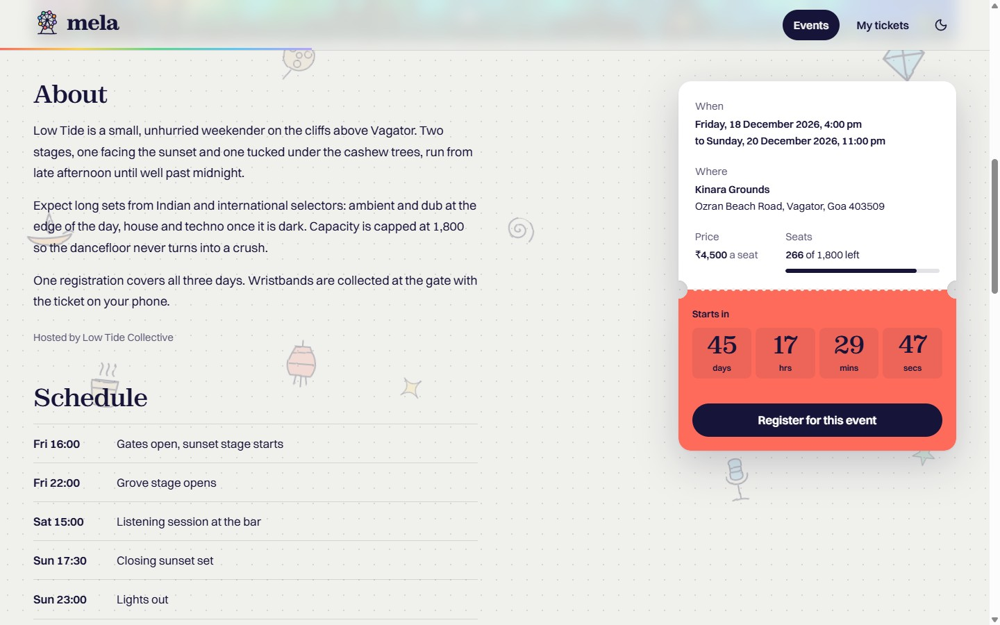
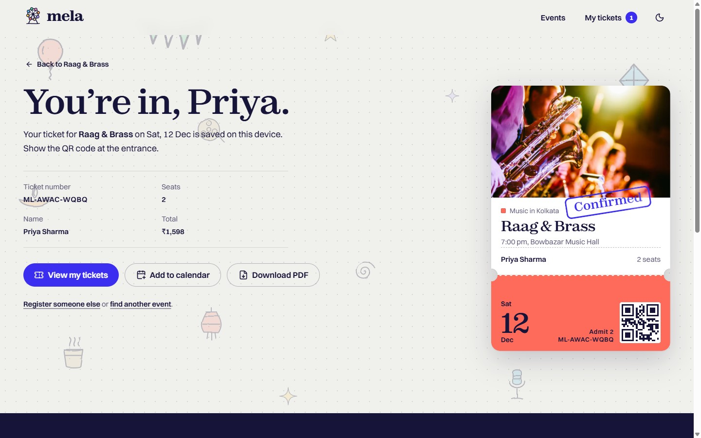
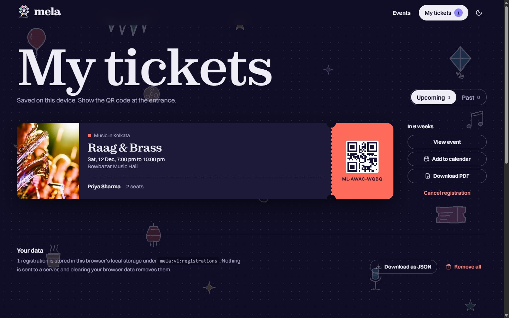
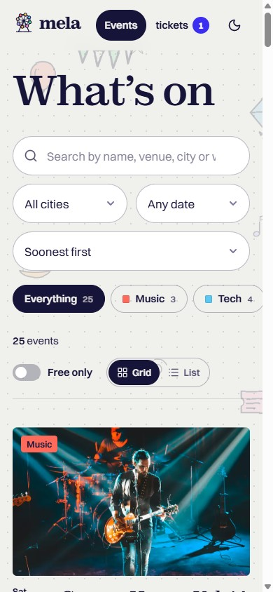

# mela: Responsive Event Management Website

**K Explore, Web Designing.** Task: *Design and Develop a Responsive Event Management Website*

mela is an event platform for eight Indian cities. You can explore upcoming events, search and filter them, open full event details, register with a validated form, and keep your tickets (with QR codes, calendar files and PDF downloads) on your device.

| | |
| --- | --- |
| **Live website** | https://mela-events-livid.vercel.app |
| **GitHub repository** | https://github.com/sayanx64/mela-events |
| **Hosting** | Vercel (production deployment) |
| **Stack** | HTML5, CSS3, JavaScript (ES modules), React 19, Tailwind CSS 4 |



---

## Assignment checklist

Every requirement in the brief, and where to find it in the site and the code.

### Core requirements

| Requirement from the brief | How it is implemented | Where |
| --- | --- | --- |
| Modern, visually appealing, fully responsive website | Custom design system (Zodiak + Switzer type, raffle-ticket colour per category), layouts tested at 375px, 768px and 1440px | `src/styles/index.css` |
| Attractive hero section introducing the platform | Headline with letter-by-letter reveal, search box, city shortcuts, a draggable stack of "next up" tickets with live countdowns, drifting photo wall | `src/pages/Home.jsx`, `src/components/TicketStack.jsx` |
| Section showcasing upcoming and featured events | "Worth planning around" (featured events, editorial layout) and "Coming up" (next events, filterable by city) | `src/pages/Home.jsx` |
| Each event has a card with name, date, venue, image and short description | Poster-style card: photo, category, date block, title, venue and city, two-line description, price, seats left | `src/components/EventCard.jsx` |
| Browse events | Events page with all 25 events, grid view or list view grouped by month | `src/pages/Events.jsx` |
| Search for specific events | Searches title, venue, area, city, host, category, description and tags; ignores case and accents; every word must match | `src/lib/events.js` (`matchesQuery`) |
| Filter events by category | Category chips with live counts, plus extra filters for city, date range (next 7 days, next 30 days, weekends) and free events; sorting by date, price or popularity. Filters are kept in the URL so results can be shared | `src/pages/Events.jsx`, `src/hooks/useEventFilters.js` |
| Event details page with a registration option | About, schedule, good-to-know list, venue with Google Maps link, seats left, live countdown, register button, related events | `src/pages/EventDetail.jsx` |
| Registration form: name, email, phone, selected event | Full name, email, mobile number, event (dropdown grouped by month, preselected from the event page) and number of seats | `src/pages/Register.jsx` |
| JavaScript form validation | Custom JS validation (`noValidate` on the form); runs on blur and on submit; inline errors linked with `aria-describedby`; an error summary that links to each field | `src/lib/validation.js` |
| Confirmation message after successful submission | "You're in, Priya." with ticket number, seats, total, a stamped ticket with a QR code, plus View my tickets / Add to calendar / Download PDF | `src/pages/Register.jsx` (`Confirmation`) |
| Responsive on mobile, tablet and desktop | Mobile-first Tailwind breakpoints, sticky mobile register bar, horizontally scrolling chips, container-query footer | All pages |
| Good UI/UX, consistent styling, smooth transitions, interactive elements | Page cross-fades and card-to-cover image morphs (View Transitions API), Lenis smooth scrolling, GSAP text and image reveals, draggable ticket stack, undo toasts, empty states | `src/lib/motion.js`, `src/components/Layout.jsx` |
| HTML5, CSS3 and JavaScript | Semantic HTML5 (`header`, `nav`, `main`, `article`, `section`, `aside`, `time`, `dialog`, `fieldset`), modern CSS3 (custom properties, masks, `@container`, scroll-driven animations, `color-mix`), JavaScript ES modules | Throughout |
| Optional Tailwind CSS or React | Both: React 19 and Tailwind CSS 4 | `package.json` |
| Git and GitHub for version control | Public repository with a step-by-step commit history | This repo |

### Bonus challenge

| Bonus item | Implementation |
| --- | --- |
| Dark / light mode | Follows the system setting, remembers your choice in `localStorage`, no flash on load, circular reveal animation from the toggle button (`src/hooks/useTheme.js`) |
| Event countdown timers | Live days/hours/minutes/seconds countdown on every event page and on each hero ticket. One shared clock drives every countdown and pauses when the tab is hidden (`src/hooks/useNow.js`) |
| Animations | Hand-drawn sketch background that inks itself in and drifts on scroll, GSAP SplitText headline reveals, clip-path photo reveals, raffle tickets that deal in, "Confirmed" rubber stamp, parallax covers, scroll progress bar. All respect `prefers-reduced-motion` |
| Local Storage registration management | **My tickets** page: upcoming and past tickets with real QR codes, cancel with confirmation and undo, add to calendar (.ics), download a PDF ticket, export all data as JSON, remove all. Seats left update everywhere; changes sync across browser tabs |

### Submission requirements

- [x] GitHub repository link: https://github.com/sayanx64/mela-events
- [x] Deployed website link (Vercel): https://mela-events-livid.vercel.app
- [x] README explaining the project and its implementation (this file)

---

## Screenshots

| Browse and filter | Event details |
| --- | --- |
|  |  |

| Registration confirmed | My tickets (dark mode) |
| --- | --- |
|  |  |

<p align="center"></p>

---

## How it works

### Pages

| Route | Page |
| --- | --- |
| `/` | Home: hero, featured events, categories, upcoming events |
| `/events` | Browse, search, filter and sort all events (`?q=`, `?category=`, `?city=`, `?when=`, `?free=1`, `?sort=`, `?view=list`) |
| `/events/:slug` | Event details and registration panel |
| `/register?event=:slug` | Registration form and live ticket preview |
| `/tickets` | My tickets (Local Storage) |
| anything else | Friendly 404 page |

### Form validation rules (`src/lib/validation.js`)

| Field | Rule | Example message |
| --- | --- | --- |
| Event | Required, must be upcoming and not sold out | "Choose the event you want to attend." |
| Full name | 2 to 60 characters, letters from any script plus spaces, `.`, `'` and `-` | "Use letters only. Spaces, hyphens, apostrophes and full stops are fine." |
| Email | Valid address format, no spaces or double dots; suggests fixes for typos such as `gmial.com` | "Did you mean priya@gmail.com?" |
| Mobile number | Indian mobile: 10 digits starting with 6 to 9; accepts `+91`, `0` and spaces; formatted as `+91 98765 43210` | "That's 5 digits. Indian mobile numbers have 10." |
| Seats | 1 to 4 per registration, never more than the seats left | "Only 2 seats left. Choose fewer." |
| Duplicate check | The same email cannot register twice for the same event | "This email is already registered for this event." |

### Local Storage data (`src/lib/store.js`)

Registrations are saved under the key `mela:v1:registrations` as a JSON array:

```json
[
  {
    "id": "ML-AWAC-WQBQ",
    "event": "raag-and-brass",
    "name": "Priya Sharma",
    "email": "priya@example.com",
    "phone": "+91 98765 43210",
    "seats": 2,
    "createdAt": "2026-11-02T17:00:24.512Z"
  }
]
```

The store validates records as it reads them, so corrupted data is ignored rather than crashing the app. It also reports a clear error if the browser blocks storage (private mode), notifies React through `useSyncExternalStore`, and listens to the `storage` event to stay in sync across tabs. Seats left = capacity − seats already taken − seats booked on this device.

### Project structure

```
src/
  components/   Header, Footer, Layout, EventCard, EventRow, Ticket, TicketStack,
                Countdown, ConfirmDialog, Doodles (sketch background), Logo, QrCode
  data/         events.js (25 events), categories.js
  hooks/        useNow (shared clock), useRegistrations, useTheme, useEventFilters
  lib/          validation, store (Local Storage), events (search/filter/sort),
                dates (IST formatting), calendar (.ics), pdf (ticket PDF), motion (GSAP + Lenis)
  pages/        Home, Events, EventDetail, Register, Tickets, NotFound
  styles/       index.css (design tokens, components, animations), fonts.css
docs/screenshots/   images used in this README
```

### Quality

- **Tests:** 43 unit tests (Vitest) for validation, the Local Storage store, search/filter/sort, seat counting, date formatting and the calendar file. Run `npm test`.
- **Linting:** `npm run lint` (oxlint) passes with no warnings.
- **Accessibility:** semantic landmarks, skip link, visible focus states, labelled form controls, errors announced to screen readers, keyboard-operable ticket stack (arrow keys), native `<dialog>` for confirmations, `prefers-reduced-motion` support.
- **Performance and SEO:** WebP images with `srcset`, lazy loading, self-hosted and preloaded fonts, per-page `<title>`, meta description, Open Graph image, `robots.txt`, `sitemap.xml`, and a plain-HTML copy of the event list baked into `index.html` for visitors and crawlers without JavaScript.

---

## Run it locally

```bash
git clone https://github.com/sayanx64/mela-events.git
cd mela-events
npm install
npm run dev       # http://localhost:5173
npm test          # unit tests
npm run lint      # code checks
npm run build     # production build in dist/
```

Requires Node.js 22 or newer.

## Design notes

Inspiration came from Awwwards-featured festival sites: Doel Festival (huge type layered over photography) and Klangtherapie Festival (ticket cards, countdowns). For the browsing side, Luma's Discover page (categories with event counts) was the reference. The visual idea is the **ticket**: categories use raffle-ticket colours, the hero is a pile of real-looking tickets, and registering prints you a stub with a QR code.

## Credits

- Photos: [Unsplash](https://unsplash.com/license) (Unsplash License)
- Fonts: Zodiak and Switzer by Indian Type Foundry via Fontshare (ITF Free Font License), self-hosted
- Logo and background sketches: hand-drawn style SVGs made for this project
- Events, venues and hosts are fictional, created for this assignment

Built by [sayanx64](https://github.com/sayanx64).
